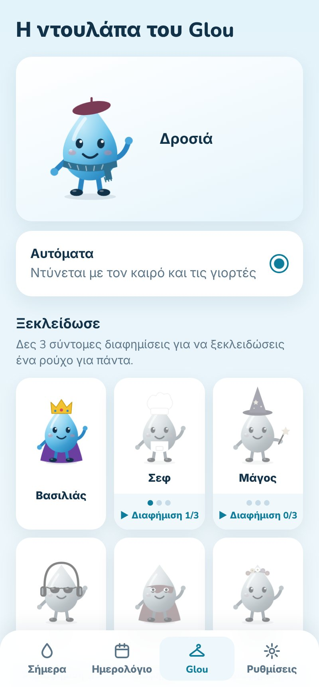
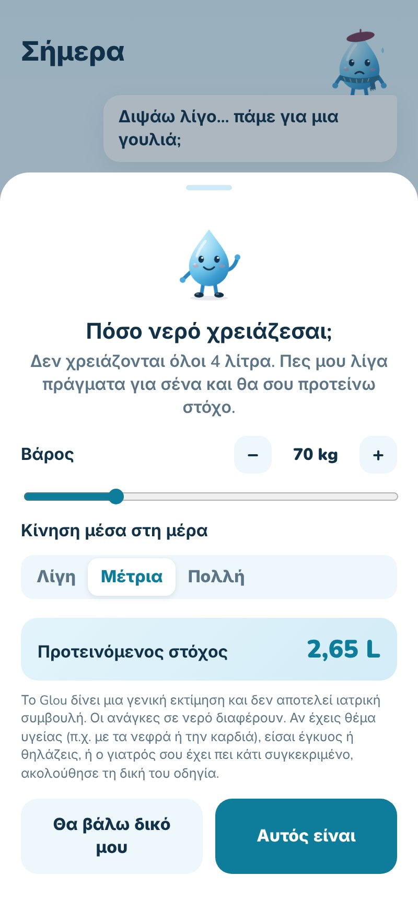
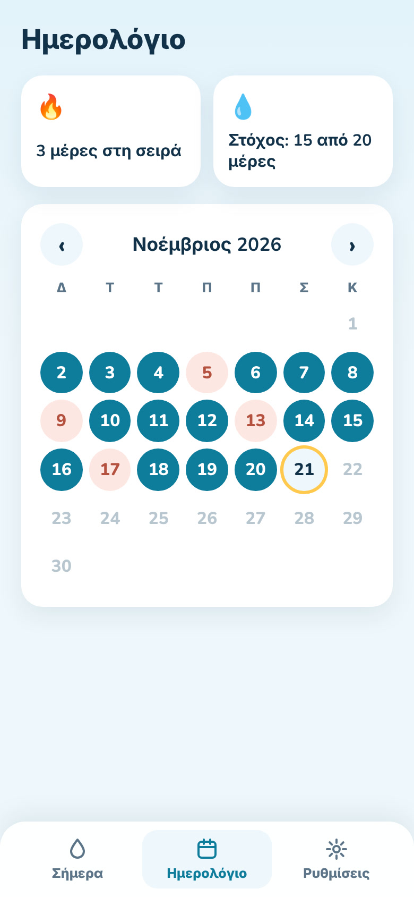
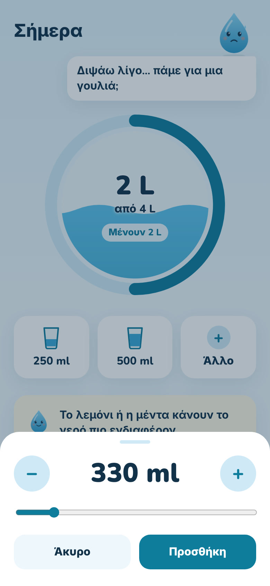

# Glou

A water tracker for Android with a mascot, Glou, and reminders that don't nag. Log a glass in one tap, see the day fill up, and keep a streak on the calendar. Glou dresses for the weather and the holidays. The app is in Greek and English, and your drinks stay on your phone.

<p>
  
  
  
  
</p>

## Features

- **One-tap logging:** 250 ml, 500 ml, or any amount from 50 ml to 2 L, with undo.
- **A goal for you, not for everyone:** on first launch Glou suggests a goal from your weight and how active you are (about 33 ml per kg, plus extra for activity, between 1.5 L and 4.5 L). On days of 30° or more it adds 0.5 L. You can also set your own goal.
- **Calendar:** each day is marked met or missed, with the current streak and the month's tally.
- **Glou the mascot:** sleepy in the morning, thirsty when the day runs ahead of you, happy on schedule and proud at the goal. Glou also shares one tip each day.
- **Glou's wardrobe:** a scarf and beanie in the cold, a raincoat and umbrella in the rain, sunglasses in the sun, and outfits for Christmas, New Year, Halloween, Valentine's and the Greek national days. With your location on, the clothes follow today's forecast; without it, they follow the season.
- **Outfits to unlock:** nine extra outfits (king, chef, wizard, DJ, superhero, spring, pirate, cowboy, gentleman), each unlocked by watching three short ads. The ad screen is a placeholder for now; real ads will use AdMob.
- **Reminders that respect you:**
  - only between the hours you wake up and go to bed, every 30 to 120 minutes;
  - quiet for one interval after you drink;
  - off for the rest of the day once you reach the goal;
  - a "Drank 250 ml" button on the notification that logs the glass without opening the app.
- **Private:** no account and no server. Your drinks are kept in the app's storage on the phone. If you turn on the weather, only a rounded location is sent to MET Norway to get the forecast.

| Calendar | Custom amount |
|---|---|
|  |  |

> **Not medical advice.** Glou gives a general estimate. Water needs vary, and people with some health conditions (for example kidney or heart conditions), or who are pregnant or breastfeeding, should follow their doctor's advice.

## Running it

Requirements: Node.js 22, and Android Studio with JDK 21 for the phone build.

```bash
npm install
npm run dev        # the app in the browser, without notifications
npm test           # unit tests
npm run android    # build, sync and open the Android project in Android Studio
```

In Android Studio, pick your phone and press **Run**. Every push to `main` also builds a debug APK, which you can download from the run's **Artifacts** on the Actions tab.

## How it's built

| Part | Tool |
|---|---|
| Interface | React 19 and Vite |
| Android app | Capacitor 7 |
| Storage | Capacitor Preferences |
| Reminders | a small native Android plugin (alarms, notification and the drink button) |
| Weather | MET Norway Locationforecast |
| Tests | Vitest |

The reminder plan is a pure function in [`src/reminders/plan.js`](src/reminders/plan.js), so its rules are tested without a phone. The app schedules the plan for the next two days and refreshes it after every drink and every time it comes back to the screen. The notifications themselves come from [`android/.../reminders`](android/app/src/main/java/com/nikpar/glou/reminders): when you tap "Drank 250 ml", a receiver writes the drink straight into the app's storage, quiets the next reminders and shows a short confirmation. Outfit rules live in [`src/lib/outfits.js`](src/lib/outfits.js) and the goal in [`src/lib/hydration.js`](src/lib/hydration.js), both with tests.

## Licence

© 2026 Nikos Parliaros. All rights reserved. See [LICENSE](LICENSE).
