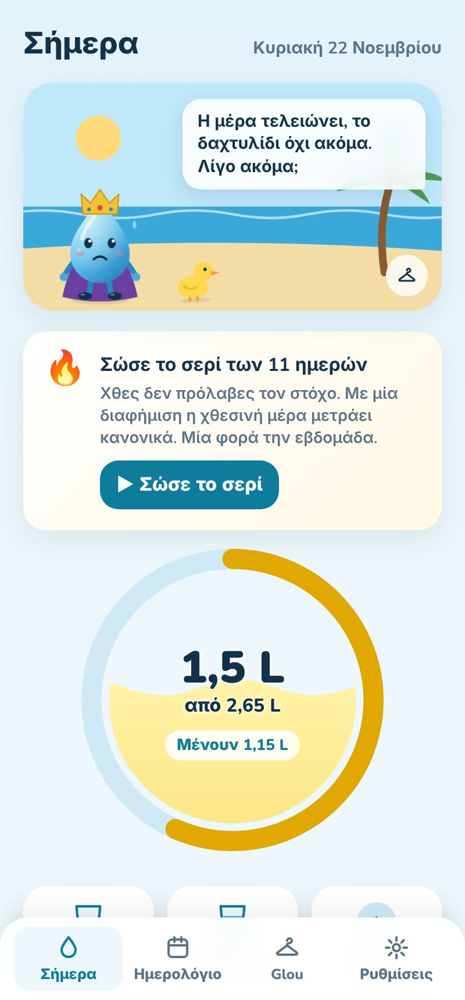
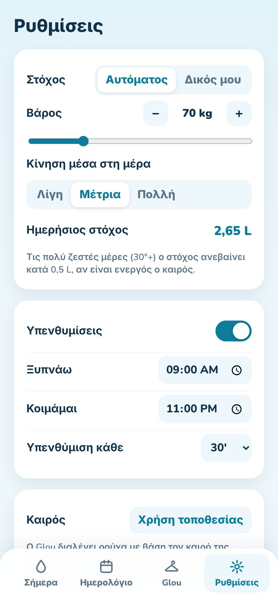
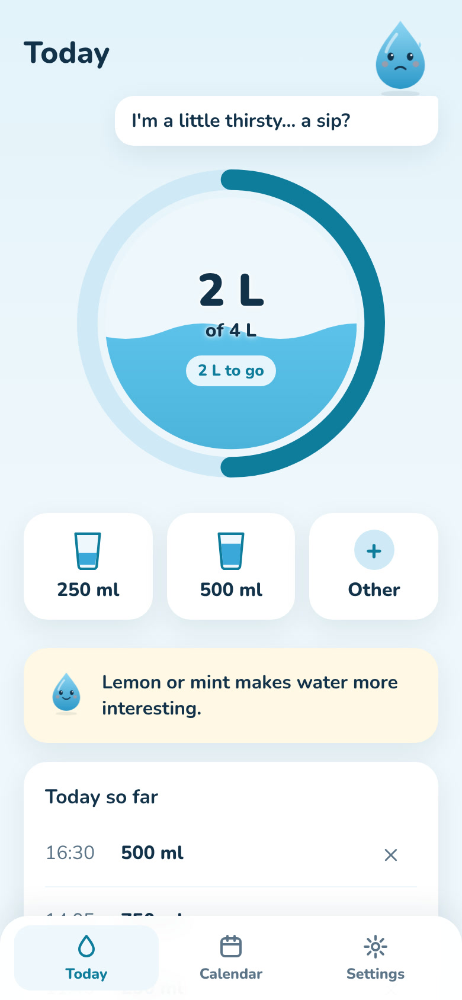

# Glou

A water tracker for Android with a mascot, Glou, and reminders that don't nag. Log a glass in one tap, see the day fill up, and keep a streak on the calendar. The app is in Greek and English, and everything stays on your phone.

<p>
  
  
  
</p>

## Features

- **One-tap logging:** 250 ml, 500 ml, or any amount from 50 ml to 2 L, with undo.
- **Daily goal:** 4 L by default, adjustable from 1.5 L to 5 L.
- **Calendar:** each day is marked met or missed, with the current streak and the month's tally.
- **Glou the mascot:** sleepy in the morning, thirsty when the day runs ahead of you, happy on schedule and proud at the goal. Glou also shares one tip each day.
- **Reminders that respect you:**
  - only between the hours you wake up and go to bed, every 30 to 120 minutes;
  - quiet for one interval after you drink;
  - off for the rest of the day once you reach the goal;
  - a "Drank 250 ml" button on the notification itself.
- **Private:** no account and no server. Your data is kept in the app's storage on the phone.

| Custom amount | In English |
|---|---|
|  |  |

## Running it

Requirements: Node.js 22, and Android Studio with JDK 21 for the phone build.

```bash
npm install
npm run dev        # the app in the browser, without notifications
npm test           # unit tests
npm run android    # build, sync and open the Android project in Android Studio
```

In Android Studio, pick your phone and press **Run**. Every push to `main` also builds a debug APK, which you can download from the run's **Artifacts** on the Actions tab.

## How it's built

| Part | Tool |
|---|---|
| Interface | React 19 and Vite |
| Android app | Capacitor 7 |
| Storage | Capacitor Preferences |
| Reminders | Capacitor Local Notifications |
| Tests | Vitest |

The reminder plan is a pure function in [`src/reminders/plan.js`](src/reminders/plan.js), so its rules are tested without a phone. The app schedules the plan for the next two days and refreshes it after every drink and every time it comes back to the screen.

## Licence

© 2026 Nikos Parliaros. All rights reserved. See [LICENSE](LICENSE).
